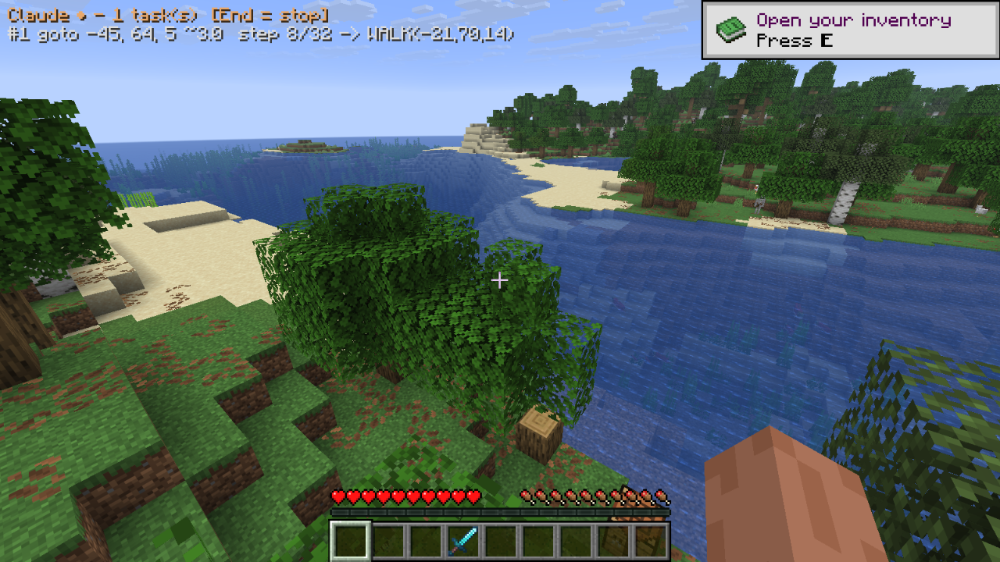
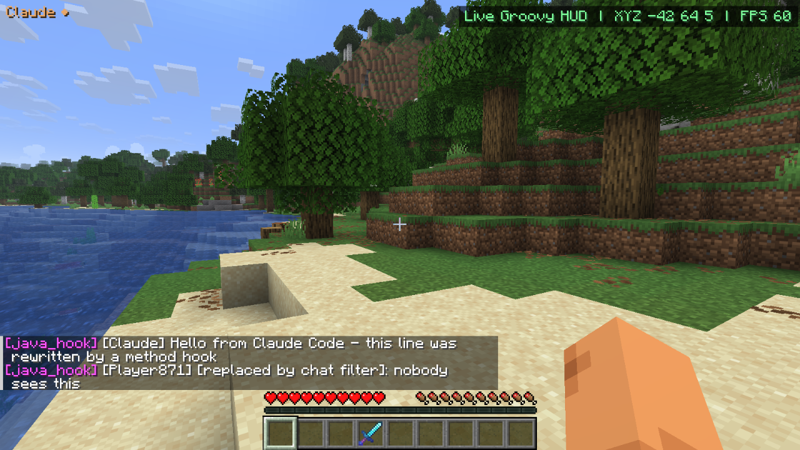
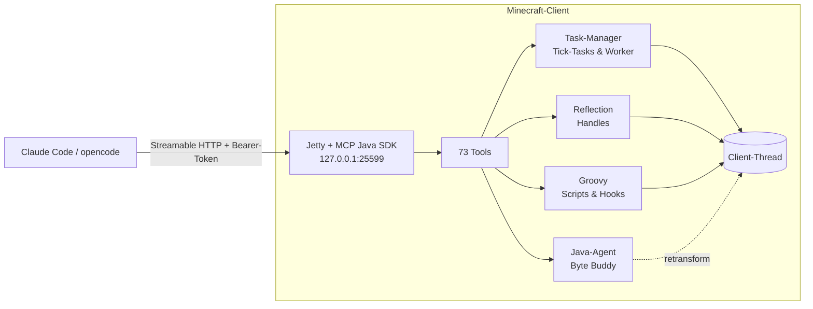

<div align="center">

# Claude MCP

**Dein Minecraft-Client als MCP-Server – gesteuert von Claude Code, opencode oder jedem anderen MCP-Client.**

[](https://www.minecraft.net/)
[](https://fabricmc.net/)
[](https://adoptium.net/)
[](https://modelcontextprotocol.io/)
[](LICENSE)



*Claude läuft per Pathfinder durch die Welt – oben links zeigt das HUD, was gerade passiert.*

</div>

---

## Was ist das?

Eine clientseitige **Fabric-Mod**, die in Minecraft einen **MCP-Server** startet. Ein KI-Agent kann damit den laufenden Client komplett übernehmen. Er sieht die Welt und läuft, baut ab, baut, craftet und kämpft. Er merkt sich Orte pro Welt. Und er greift live in den Code des Spiels ein: Java-Methoden aufrufen, Groovy-Code ausführen, **beliebige Methoden zur Laufzeit hooken**, den Chat filtern und NBT bearbeiten.

> „Hau den nächsten Baum um, bau eine Werkbank und merk dir, wo sie steht.“
> „Hook `LivingEntity.getHealth` und zeig mir, wer wie oft abgefragt wird.“
> „Ersetze jedes ‚lol‘ im Chat durch ‚😂‘.“

<div align="center">


*Gleichzeitig aktiv: ein Live-Groovy-HUD (oben rechts), ein Methoden-Hook, der Chatzeilen umschreibt (`[java_hook]`), und ein Chat-Filter.*
</div>

## Features

| | |
|---|---|
| 🧭 **Wahrnehmung** | Zustand als JSON (Position, Leben, Hunger, Blickziel, Biom …), Blöcke und Entities in der Umgebung, Inventar, GUI-Inhalte, Screenshots |
| 🚶 **Bewegung** | Eigener A*-Pathfinder: Laufen, Springen, Fallen, Schwimmen, Klettern, Graben durch Hindernisse. Schutz gegen Ertrinken und zu wenig Leben |
| ⛏️ **Aktionen** | Abbauen mit automatischer Werkzeugwahl und Aufsammeln, Platzieren, Interagieren, Craften über das Rezeptbuch, Kämpfen, Folgen, GUI-Klicks, Tippen |
| ⏱️ **Tasks** | Lange Aktionen laufen als Task mit ID, Fortschritt, Abbruch und Not-Stopp (`End`-Taste) |
| 🧠 **Memory** | Notizen, Key/Value-Einträge und Wegpunkte, getrennt pro Welt bzw. Server, als JSON gespeichert |
| ☕ **Reflection** | Jede Klasse und jedes Objekt des Spiels: Felder lesen und schreiben, Methoden aufrufen, Objekte erzeugen (Mojang-Namen) |
| 📜 **Groovy** | Live-Code im Spiel, synchron im Client-Thread oder als abbrechbarer Task, gespeicherte Scripts, Event-Hooks (Tick, Chat, Schaden, HUD, Tasten …) |
| 🪝 **Methoden-Hooks** | Jede Methode zur Laufzeit hooken (Java-Agent + Byte Buddy): Aufrufe mitschneiden, Argumente ändern, Rückgabewerte ersetzen, Aufrufe abbrechen |
| 💬 **Chat** | Lesen per Event-Stream, Senden, Filtern und Umschreiben von ein- und ausgehenden Nachrichten (Regeln oder Groovy) |
| 🏷️ **NBT-Editor** | Kisten, Schilder, Spawner, Entities, Spieler und Items mit Komponenten lesen und bearbeiten, Pfade wie bei `/data` |

## Schnellstart

### 1. Mod installieren

Lege in einer **Fabric-Instanz für Minecraft 26.3** (z. B. mit [Prism Launcher](https://prismlauncher.org/)) diese Dateien in `mods/`:

- `claude-mcp-<version>.jar` – selbst bauen mit `.\gradlew build`, die Jar liegt dann unter `build/libs/`
- [Fabric API](https://modrinth.com/mod/fabric-api) **≥ 0.165.0**

Starte Minecraft einmal. Dabei werden `config/claudemcp/token.txt` und `config.json` angelegt.

### 2a. Mit Claude Code verbinden

```powershell
.\register.ps1                                         # sucht die Prism-Instanz "Fabric 26.3"
.\register.ps1 -ConfigDir "<instanz>\minecraft\config\claudemcp"
```

Das Skript trägt den Server als `minecraft` im User-Scope ein. Optional kopierst du den Skill [`skill/minecraft-control`](skill/minecraft-control/SKILL.md) nach `~/.claude/skills/`. Er bringt Claude bei, wie die Tools sinnvoll zusammenspielen.

### 2b. Mit opencode verbinden

In `~/.config/opencode/opencode.json`:

```json
"mcp": {
  "minecraft": {
    "type": "remote",
    "url": "http://127.0.0.1:25599/mcp",
    "headers": { "Authorization": "Bearer {file:<instanz>/minecraft/config/claudemcp/token.txt}" },
    "enabled": true
  }
}
```

> 💡 **Tipp für lokale Modelle:** 73 Tool-Beschreibungen kosten viel Kontext. Schalte nicht benötigte Tools über `"tools": { "minecraft_goto": false, … }` ab.

### 3. Loslegen

Minecraft starten, eine Welt betreten und dem Agenten sagen, was er tun soll. Der Server existiert nur, solange das Spiel läuft.

## Im Spiel

| | |
|---|---|
| **HUD** (oben links) | zeigt laufende Tasks und eingehende MCP-Anfragen |
| **`End`** | stoppt sofort alle Tasks und Scripts (unter *Steuerung* umbelegbar) |
| **Eigene Eingabe** | WASD, Springen und Klicks brechen Bewegungs-Tasks ab, du hast immer Vorrang |

## Methoden-Hooks zur Laufzeit

`java_hook` patcht jede Methode des Spiels oder einer Mod, **ohne Neustart**. Ein Java-Agent hängt sich per Self-Attach an den laufenden Prozess, und Byte Buddy schreibt die Klasse per Retransformation um.

```jsonc
// Nur mitschneiden, wer getHealth() aufruft – Ergebnisse mit java_hook_calls
{ "class": "LivingEntity", "method": "getHealth", "max_calls": 100 }

// Rückgabewert ersetzen
{ "class": "LivingEntity", "method": "getHealth",
  "after": "if (self instanceof net.minecraft.client.player.LocalPlayer) hook.setResult(7.5)" }

// Argumente umschreiben
{ "class": "ChatComponent", "method": "addClientSystemMessage",
  "before": "args[0] = net.minecraft.network.chat.Component.literal('[hook] ' + args[0].string)" }
```

- **`before`**: Variablen `self`, `args`, `method`, `hook`. Mit `hook.cancel(wert)` wird das Original übersprungen.
- **`after`**: zusätzlich `result` und `thrown`. Mit `hook.setResult(wert)` wird der Rückgabewert ersetzt.
- Entfernt man den letzten Hook einer Methode, ist der Original-Bytecode wieder da.
- Hooks laufen auf dem aufrufenden Thread mit 50 ms Limit und schalten sich nach 5 Fehlern selbst ab.
- JDK-Klassen und die Mod selbst sind tabu. Falls sich der Agent nicht anhängen kann, hilft das JVM-Argument `-Djdk.attach.allowAttachSelf=true`.

## Groovy live im Spiel

```groovy
// nächste 5 Stämme fällen
5.times {
  def log = api.findBlocks("oak_log", 24, 1)
  if (!log) return
  def p = log[0].pos
  api.mine(p[0], p[1], p[2])
}
api.inventory().items.findAll { it.id.endsWith("_log") }
```

Verfügbar sind `mc`, `player`, `level`, `gameMode`, `screen`, `api`, `memory`, `args` und `out`. Game-Objekte fasst man in Worker-Scripts innerhalb von `api.onMain { … }` an. Mit `sync: true` läuft kurzer Code direkt im Client-Thread.

## NBT-Editor

```jsonc
// Kiste umbenennen und füllen
nbt_set  { "target": "block", "x": -12, "y": 70, "z": 17,
           "snbt": "{CustomName:\"Claudes Kiste\",Items:[{Slot:0b,id:\"minecraft:diamond\",count:42}]}" }

// Item mit Komponenten erzeugen
nbt_give { "snbt": "{id:\"minecraft:diamond_sword\",count:1,components:{\"minecraft:custom_name\":\"Excalibur\"}}" }
```

| | Singleplayer | Server |
|---|---|---|
| Blöcke und Entities | direkt auf dem integrierten Server | über `/data`-Befehle (OP nötig) |
| Items | direkt | nur im Kreativmodus (Creative-Paket) |
| Spieler | direkt | nicht möglich |

## Architektur



## Sicherheit

- Der Server lauscht **nur auf `127.0.0.1`** und verlangt ein zufälliges **Bearer-Token**.
- Scripts und Reflection bedeuten volle Codeausführung im Spielprozess. Beides lässt sich in `config/claudemcp/config.json` abschalten (`enableScripts`, `enableReflection`).
- Die Mod ist rein clientseitig und funktioniert in Singleplayer und auf Servern. **Anticheat-Umgehung ist bewusst nicht eingebaut.** Halte dich an die Regeln der Server, auf denen du spielst.

<details>
<summary><b>📋 Alle 73 Tools</b></summary>

| Gruppe | Tools |
|---|---|
| Zustand | `get_state`, `get_blocks`, `find_blocks`, `get_entities`, `get_inventory`, `get_screen`, `screenshot` |
| Aktionen | `goto`, `follow`, `look_at`, `set_rotation`, `move`, `mine_block`, `place_block`, `interact_block`, `interact_entity`, `use_item`, `attack`, `select_slot`, `click_slot`, `click_widget`, `click_at`, `type_text`, `press_key`, `open_inventory`, `close_screen`, `craft`, `list_recipes`, `chat`, `run_command`, `client_message` |
| Tasks | `task_status`, `task_wait`, `task_cancel`, `stop_all` |
| Ereignisse | `get_events` (mit Long-Polling), `get_log` |
| Memory | `memory_put`, `memory_get`, `memory_search`, `memory_delete`, `waypoint_set`, `waypoint_list`, `waypoint_delete`, `waypoint_goto` |
| Reflection | `java_find_class`, `java_describe`, `java_get_field`, `java_set_field`, `java_invoke`, `java_new`, `handle_release` |
| Script | `script_eval`, `script_save`, `script_run`, `script_list`, `script_get`, `script_delete`, `hook_register`, `hook_list`, `hook_remove` |
| Methoden-Hooks | `java_hook`, `java_hook_calls`, `java_hook_list`, `java_hook_remove`, `java_hook_enable` |
| Chat-Filter | `chat_rule_add`, `chat_rule_list`, `chat_rule_remove` (+ Hook-Events `chat_in`/`chat_out`) |
| NBT | `nbt_get`, `nbt_set`, `nbt_remove`, `nbt_give` |

Längere Aktionen laufen als Task. Mit `wait` (Sekunden) wartet der Aufruf direkt auf das Ergebnis, sonst kommt sofort eine Task-ID zurück.

</details>

<details>
<summary><b>🛠️ Entwicklung</b></summary>

```powershell
.\gradlew build                 # Jar + Unit-Tests (Pathfinder, Overloads, Memory/Events, NBT)
.\gradlew runClient             # Dev-Client (run/), MCP auf Port 25599
.\gradlew runClientGameTest     # End-to-End: echter Client, Testwelt, alle Kernfunktionen über MCP-HTTP
```

**Stack:**
- Build: Gradle 9.8.2, Fabric Loom 1.19.3, Fabric API 0.165.2+26.3
- Bibliotheken: MCP Java SDK 2.1.0, Jetty 12.1 (ee11), Groovy 5.1.3, Byte Buddy 1.18.17, alle als Jar-in-Jar in der Mod
- JDK: Gradle sucht sich ein installiertes JDK 25 selbst (`gradle/gradle-daemon-jvm.properties`). Das Standard-Java des Systems darf älter sein.

**Besonderheiten von 26.3:**
- **Mojang-Namen:** Der Code ist nicht mehr obfuskiert. Viele Klassen heißen anders als in 1.21, zum Beispiel `GuiGraphicsExtractor`, `mc.gui.screen()` und `Hud.toggle()`.
- **Tastencodes:** Es sind SDL-Scancodes statt GLFW-Codes. Den richtigen Code liefert `InputConstants.getKey("key.keyboard.w")`.
- **Buttons:** Synthetische `mouseClicked`-Events lösen Buttons nicht überall aus. `click_widget` ruft deshalb `onPress` auf.
- **Threads:** Das MCP SDK erzeugt Reactor-Threads, die keine Daemon-Threads sind. Eine eigene Scheduler-Factory hält den Shutdown sauber.

</details>

## Lizenz und Namensnennung

Copyright 2026 **[Hemiize](https://github.com/Hemiize)** · [Apache License 2.0](LICENSE)

> [!IMPORTANT]
> **Namensnennung ist Pflicht.** Wer dieses Projekt oder Teile davon weitergibt, zum Beispiel als Fork, Modpack oder eigene Mod, muss die Datei [NOTICE](NOTICE) mitliefern. Darin wird **Hemiize** als ursprünglicher Autor mit Link auf dieses Repository genannt (Abschnitt 4 der Apache-Lizenz).

Die mitgelieferten Bibliotheken behalten ihre eigenen Lizenzen (MCP Java SDK, Jetty, Groovy, Byte Buddy, Jackson, Reactor). *Minecraft* ist eine Marke von Mojang/Microsoft. Dieses Projekt ist inoffiziell und steht in keiner Verbindung zu Mojang, Microsoft oder Anthropic.
