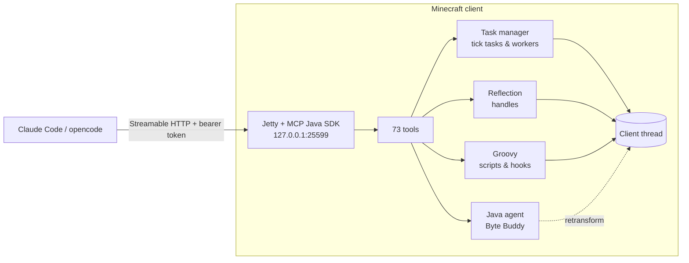

<div align="center">

# Claude MCP

**Turn your Minecraft client into an MCP server – controlled by Claude Code, opencode or any other MCP client.**

[](https://www.minecraft.net/)
[](https://fabricmc.net/)
[](https://adoptium.net/)
[](https://modelcontextprotocol.io/)
[](LICENSE)
[](https://github.com/Hemiize/mc-claude-mcp/releases/latest)


*Claude walks through the world using its pathfinder – the HUD in the top left shows what is happening.*

</div>

---

## What is this?

A client-side **Fabric mod** that starts an **MCP server** inside Minecraft. An AI agent can then take full control of the running client. It sees the world, walks, mines, builds, crafts and fights. It remembers places per world. And it can reach into the game's code live: call Java methods, run Groovy code, **hook any method at runtime**, filter the chat and edit NBT.

> "Chop down the nearest tree, build a crafting table and remember where it is."
> "Hook `LivingEntity.getHealth` and show me who calls it how often."
> "Replace every 'lol' in the chat with '😂'."

<div align="center">


*Active at the same time: a live Groovy HUD (top right), a method hook that rewrites chat lines (`[java_hook]`) and a chat filter.*
</div>

## Features

| | |
|---|---|
| 🧭 **Perception** | State as JSON (position, health, hunger, crosshair target, biome …), nearby blocks and entities, inventory, GUI contents, screenshots |
| 🚶 **Movement** | Custom A* pathfinder: walking, jumping, falling, swimming, climbing, digging through obstacles. Protection against drowning and low health |
| ⛏️ **Actions** | Mining with automatic tool choice and item pickup, placing, interacting, crafting via the recipe book, fighting, following, GUI clicks, typing |
| ⏱️ **Tasks** | Long actions run as tasks with ID, progress, cancellation and an emergency stop (`End` key) |
| 🧠 **Memory** | Notes, key/value entries and waypoints, separate per world or server, stored as JSON |
| ☕ **Reflection** | Every class and object of the game: read and write fields, call methods, create objects (Mojang names) |
| 📜 **Groovy** | Live code inside the game, synchronously on the client thread or as a cancellable task, saved scripts, event hooks (tick, chat, damage, HUD, keys …) |
| 🪝 **Method hooks** | Hook any method at runtime (Java agent + Byte Buddy): trace calls, change arguments, replace return values, cancel calls |
| 💬 **Chat** | Read via event stream, send, filter and rewrite incoming and outgoing messages (rules or Groovy) |
| 🏷️ **NBT editor** | Read and edit chests, signs, spawners, entities, the player and items with components, paths like in `/data` |

## Quick start

### 1. Install the mod

Put these files into `mods/` of a **Fabric instance for Minecraft 26.3** (e.g. with [Prism Launcher](https://prismlauncher.org/)):

- `claude-mcp-<version>.jar` – [**download the latest release**](https://github.com/Hemiize/mc-claude-mcp/releases/latest) or build it yourself with `.\gradlew build` (the jar ends up in `build/libs/`)
- [Fabric API](https://modrinth.com/mod/fabric-api) **≥ 0.165.0**

Start Minecraft once. This creates `config/claudemcp/token.txt` and `config.json`.

### 2a. Connect Claude Code

```powershell
.\register.ps1                                         # looks for the Prism instance "Fabric 26.3"
.\register.ps1 -ConfigDir "<instance>\minecraft\config\claudemcp"
```

The script registers the server as `minecraft` in the user scope. Optionally copy the skill [`skill/minecraft-control`](skill/minecraft-control/SKILL.md) to `~/.claude/skills/`. It teaches Claude how the tools work together.

### 2b. Connect opencode

In `~/.config/opencode/opencode.json`:

```json
"mcp": {
  "minecraft": {
    "type": "remote",
    "url": "http://127.0.0.1:25599/mcp",
    "headers": { "Authorization": "Bearer {file:<instance>/minecraft/config/claudemcp/token.txt}" },
    "enabled": true
  }
}
```

> 💡 **Tip for local models:** 73 tool descriptions take up a lot of context. Disable the tools you don't need with `"tools": { "minecraft_goto": false, … }`.

### 3. Play

Start Minecraft, join a world and tell the agent what to do. The server only exists while the game is running.

## In game

| | |
|---|---|
| **HUD** (top left) | shows running tasks and incoming MCP requests |
| **`End`** | immediately stops all tasks and scripts (rebindable under *Controls*) |
| **Your own input** | WASD, jumping and clicks cancel movement tasks – you always take precedence |

## Runtime method hooks

`java_hook` patches any method of the game or of a mod, **without a restart**. A Java agent self-attaches to the running process and Byte Buddy rewrites the class via retransformation.

```jsonc
// Only trace who calls getHealth() – read the results with java_hook_calls
{ "class": "LivingEntity", "method": "getHealth", "max_calls": 100 }

// Replace the return value
{ "class": "LivingEntity", "method": "getHealth",
  "after": "if (self instanceof net.minecraft.client.player.LocalPlayer) hook.setResult(7.5)" }

// Rewrite arguments
{ "class": "ChatComponent", "method": "addClientSystemMessage",
  "before": "args[0] = net.minecraft.network.chat.Component.literal('[hook] ' + args[0].string)" }
```

- **`before`**: variables `self`, `args`, `method`, `hook`. `hook.cancel(value)` skips the original method.
- **`after`**: additionally `result` and `thrown`. `hook.setResult(value)` replaces the return value.
- Removing the last hook of a method restores the original bytecode.
- Hooks run on the calling thread with a 50 ms limit and disable themselves after 5 errors.
- JDK classes and the mod itself can't be hooked. If the agent cannot attach, the JVM argument `-Djdk.attach.allowAttachSelf=true` helps.

## Live Groovy in the game

```groovy
// chop the nearest 5 logs
5.times {
  def log = api.findBlocks("oak_log", 24, 1)
  if (!log) return
  def p = log[0].pos
  api.mine(p[0], p[1], p[2])
}
api.inventory().items.findAll { it.id.endsWith("_log") }
```

Available variables: `mc`, `player`, `level`, `gameMode`, `screen`, `api`, `memory`, `args` and `out`. In worker scripts, touch game objects inside `api.onMain { … }`. With `sync: true` short code runs directly on the client thread.

## NBT editor

```jsonc
// rename and fill a chest
nbt_set  { "target": "block", "x": -12, "y": 70, "z": 17,
           "snbt": "{CustomName:\"Claude's chest\",Items:[{Slot:0b,id:\"minecraft:diamond\",count:42}]}" }

// create an item with components
nbt_give { "snbt": "{id:\"minecraft:diamond_sword\",count:1,components:{\"minecraft:custom_name\":\"Excalibur\"}}" }
```

| | Singleplayer | Server |
|---|---|---|
| Blocks and entities | directly on the integrated server | via `/data` commands (OP required) |
| Items | directly | creative mode only (creative inventory packet) |
| Player | directly | not possible |

## Architecture



## Security

- The server listens **only on `127.0.0.1`** and requires a random **bearer token**.
- Scripts and reflection mean full code execution in the game process. Both can be disabled in `config/claudemcp/config.json` (`enableScripts`, `enableReflection`).
- The mod is purely client-side and works in singleplayer and on servers. **Anti-cheat bypasses are deliberately not included.** Follow the rules of the servers you play on.

<details>
<summary><b>📋 All 73 tools</b></summary>

| Group | Tools |
|---|---|
| State | `get_state`, `get_blocks`, `find_blocks`, `get_entities`, `get_inventory`, `get_screen`, `screenshot` |
| Actions | `goto`, `follow`, `look_at`, `set_rotation`, `move`, `mine_block`, `place_block`, `interact_block`, `interact_entity`, `use_item`, `attack`, `select_slot`, `click_slot`, `click_widget`, `click_at`, `type_text`, `press_key`, `open_inventory`, `close_screen`, `craft`, `list_recipes`, `chat`, `run_command`, `client_message` |
| Tasks | `task_status`, `task_wait`, `task_cancel`, `stop_all` |
| Events | `get_events` (with long polling), `get_log` |
| Memory | `memory_put`, `memory_get`, `memory_search`, `memory_delete`, `waypoint_set`, `waypoint_list`, `waypoint_delete`, `waypoint_goto` |
| Reflection | `java_find_class`, `java_describe`, `java_get_field`, `java_set_field`, `java_invoke`, `java_new`, `handle_release` |
| Scripts | `script_eval`, `script_save`, `script_run`, `script_list`, `script_get`, `script_delete`, `hook_register`, `hook_list`, `hook_remove` |
| Method hooks | `java_hook`, `java_hook_calls`, `java_hook_list`, `java_hook_remove`, `java_hook_enable` |
| Chat filter | `chat_rule_add`, `chat_rule_list`, `chat_rule_remove` (+ hook events `chat_in`/`chat_out`) |
| NBT | `nbt_get`, `nbt_set`, `nbt_remove`, `nbt_give` |

Long actions run as tasks. With `wait` (seconds) the call waits for the result directly, otherwise it returns a task ID right away.

</details>

<details>
<summary><b>🛠️ Development</b></summary>

```powershell
.\gradlew build                 # jar + unit tests (pathfinder, overloads, memory/events, NBT)
.\gradlew runClient             # dev client (run/), MCP on port 25599
.\gradlew runClientGameTest     # end-to-end: real client, test world, all core features over MCP HTTP
```

**Stack:**
- Build: Gradle 9.8.2, Fabric Loom 1.19.3, Fabric API 0.165.2+26.3
- Libraries: MCP Java SDK 2.1.0, Jetty 12.1 (ee11), Groovy 5.1.3, Byte Buddy 1.18.17, all bundled as jar-in-jar
- JDK: Gradle finds an installed JDK 25 by itself (`gradle/gradle-daemon-jvm.properties`). The system's default Java may be older.

**Things worth knowing about 26.3:**
- **Mojang names:** The code is no longer obfuscated. Many classes are named differently than in 1.21, e.g. `GuiGraphicsExtractor`, `mc.gui.screen()` and `Hud.toggle()`.
- **Key codes:** They are SDL scancodes, not GLFW codes. `InputConstants.getKey("key.keyboard.w")` returns the right code.
- **Buttons:** Synthetic `mouseClicked` events don't trigger buttons on every screen. `click_widget` therefore calls `onPress`.
- **Threads:** The MCP SDK creates non-daemon Reactor threads. A custom scheduler factory keeps the shutdown clean.

</details>

## License and attribution

Copyright 2026 **[Hemiize](https://github.com/Hemiize)** · [Apache License 2.0](LICENSE)

> [!IMPORTANT]
> **Attribution is required.** Anyone who redistributes this project or parts of it – as a fork, in a modpack or in their own mod – must include the [NOTICE](NOTICE) file. It credits **Hemiize** as the original author with a link to this repository (section 4 of the Apache License).

The bundled libraries keep their own licenses (MCP Java SDK, Jetty, Groovy, Byte Buddy, Jackson, Reactor). *Minecraft* is a trademark of Mojang/Microsoft. This project is unofficial and not affiliated with Mojang, Microsoft or Anthropic.
